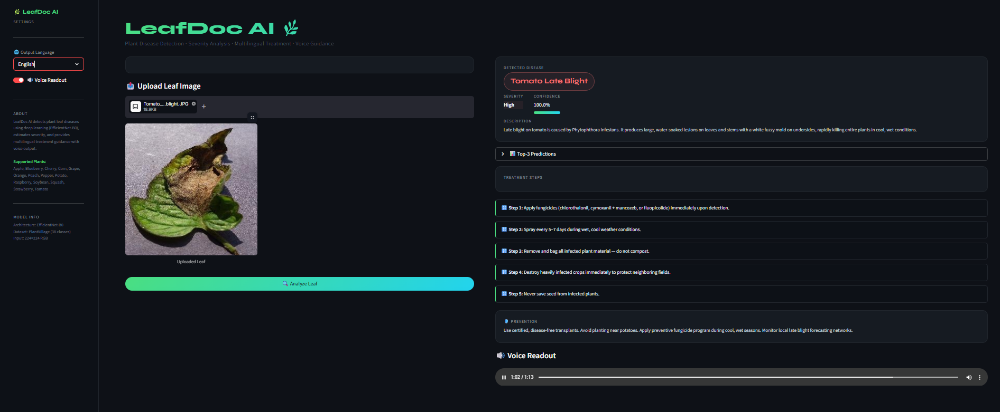

# 🌿 LeafDoc AI – Plant Disease Detection

<p align="center">
  
</p>

**LeafDoc AI** is a deep learning-based plant disease detection application that identifies diseases from leaf images and provides actionable treatment and prevention guidance.

### ✨ Features
- Plant disease detection across 38 classes.
- Disease severity analysis and confidence scores.
- Top-3 prediction results.
- Multilingual diagnosis and translation.
- Voice-based treatment guidance.
- Disease-specific treatment and prevention recommendations.

### 🛠️ Tech Stack
Python · PyTorch · Streamlit · OpenCV · Deep Learning

### 🚀 Run Locally

```bash
pip install -r requirements.txt
streamlit run app.py
```

---

*Built with 🌱 to support smarter plant healthcare.*
